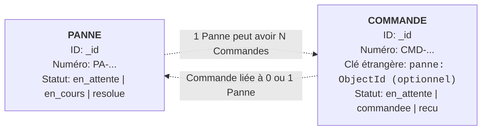
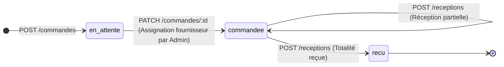

# 📋 Spécification Technique Backend — Modules Panne & Commande

> **Document de Référence & Contrat d'API**  
> **Version :** 1.1.0  
> **Statut :** Validé & Stable  
> **Public cible :** Équipe Frontend / Intégration API

---

## 📑 Sommaire

1. [Architecture Globale & Relation Panne ↔ Commande](#1-architecture-globale--relation-panne--commande)
2. [Règles Métier Clés & Comportements Automatiques](#2-règles-métier-clés--comportements-automatiques)
3. [Module Panne — Référentiel Exhaustif des Endpoints](#3-module-panne--référentiel-exhaustif-des-endpoints)
   - [`GET /api/v1/pannes/options`](#31-get-apiv1pannesoptions--options-dynamiques-ui)
   - [`GET /api/v1/pannes`](#32-get-apiv1pannes--lister-les-pannes-avec-filtres--pagination)
   - [`GET /api/v1/pannes/:id`](#33-get-apiv1pannesid--fiche-détaillée--commandes-associées)
   - [`POST /api/v1/pannes`](#34-post-apiv1pannes--déclarer-une-nouvelle-panne)
   - [`PATCH /api/v1/pannes/:id`](#35-patch-apiv1pannesid--modifier-une-panne)
   - [`PATCH /api/v1/pannes/:id/statut`](#36-patch-apiv1pannesidstatut--changer-le-statut-dune-panne)
   - [`DELETE /api/v1/pannes/:id`](#37-delete-apiv1pannesid--supprimer-une-panne-soft-delete)
4. [Module Commande — Référentiel Exhaustif des Endpoints](#4-module-commande--référentiel-exhaustif-des-endpoints)
   - [`GET /api/v1/commandes`](#41-get-apiv1commandes--lister-les-commandes-avec-filtres--pagination)
   - [`GET /api/v1/commandes/:id`](#42-get-apiv1commandesid--fiche-détaillée-dune-commande)
   - [`POST /api/v1/commandes`](#43-post-apiv1commandes--créer-une-nouvelle-commande)
   - [`PATCH /api/v1/commandes/:id`](#44-patch-apiv1commandesid--mettre-à-jour-les-articles--devis)
   - [`PATCH /api/v1/commandes/:id/status`](#45-patch-apiv1commandesidstatus--émettre-ou-annuler-une-commande)
   - [`POST /api/v1/commandes/:id/receptions`](#46-post-apiv1commandesidreceptions--enregistrer-une-livraison--réception)
   - [`DELETE /api/v1/commandes/:id`](#47-delete-apiv1commandesid--supprimer-une-commande-soft-delete)
   - [`POST /api/v1/commandes/:id/bon-signe`](#48-post-apiv1commandesidbon-signe--téléverser-le-bon-de-commande-signé)
   - [`DELETE /api/v1/commandes/:id/bon-signe`](#49-delete-apiv1commandesidbon-signe--supprimer-le-bon-de-commande-signé)
5. [Matrice des Codes d'Erreur & Réponses Standard](#5-matrice-des-codes-derreur--réponses-standard)

---

## 1. Architecture Globale & Relation Panne ↔ Commande



### Principes Directeurs
* **Liaison optionnelle :** Le schéma `Commande` contient le champ `panne` (`ObjectId`, optionnel/nullable). Une commande peut être créée directement sans panne (réapprovisionnement).
* **Peuplement automatique :** Lors de l'appel à `GET /api/v1/pannes/:id`, le backend exécute automatiquement une agrégation pour injecter le tableau `commandes[]` avec les informations essentielles de chaque commande liée.

---

## 2. Règles Métier Clés & Comportements Automatiques

### 2.1 Articles Catalogue vs Hors-Catalogue
Le backend autorise deux formats d'articles dans une commande :

| Type d'article | Identification | Comportement Backend |
| :--- | :--- | :--- |
| **Catalogue** | `equipement` (ObjectId) | L'équipement existe déjà dans le catalogue. Le backend vérifie sa présence. |
| **Hors-Catalogue** | `typeEquipement` (ObjectId) + `designation` (String) | L'équipement n'est pas encore au catalogue. Il sera **auto-créé** lors de la réception physique. |

---

### 2.2 Règle d'Affectation du `prixUnitaire` à la Création
* **Comportement par défaut (`utiliserPrixCatalogue: false` ou omis) :**  
  Le `prixUnitaire` est initialisé à `0` (sauf si une valeur explicite est transmise dans l'article).
* **Option Catalogue activée (`utiliserPrixCatalogue: true`) :**  
  Pour les articles catalogue dont le prix n'est pas précisé (`=== 0`), le backend injecte automatiquement le dernier prix catalogue connu (`catalogItem.prix`), à condition que `prix > 0`.
* **Articles Hors-Catalogue :**  
  Le prix reste toujours à `0` à la création (le coût réel sera saisi à la réception).
* **Règle de priorité :**  
  Toute valeur de `prixUnitaire` explicitement fournie par l'appelant est **toujours prioritaire**.

---

### 2.3 Cycle de Vie des Statuts de Commande



---

### 2.4 Automatismes lors de la Réception (`POST /receptions`)
Dès qu'une réception physique est enregistrée :
1. **Mise à jour des quantités reçues :** `quantiteRecue` est incrémenté sur chaque ligne d'équipement.
2. **Transition de statut automatique :** Si tous les équipements ont atteint leur quantité commandée (`quantiteRecue === quantiteCommandee`), le statut passe automatiquement à `recu` ; sinon, il reste à `commandee`.
3. **Calcul automatique du `prixtotal` :** Calculé en temps réel selon la formule officielle :
   $$\text{prixtotal} = \sum (\text{quantiteRecue} \times \text{prixUnitaire})$$
4. **Historisation du prix :** Le prix unitaire d'achat constaté met à jour l'historique d'achat de l'équipement.
5. **Verrouillage d'immuabilité :** Dès la première réception, les prix unitaires reçus sont figés. L'annulation ou la suppression de la commande devient **strictement interdite** (`409 Conflict`).

---

## 3. Module Panne — Référentiel Exhaustif des Endpoints

### 3.1 `GET /api/v1/pannes/options` — Options Dynamiques UI
Permet de récupérer les listes d'énumérations pour alimenter dynamiquement les menus déroulants et filtres de l'interface.

* **Authentification :** Requise (`Bearer Token`)
* **Méthode :** `GET`
* **Réponse HTTP :** `200 OK`

```json
{
  "success": true,
  "data": {
    "types_panne": ["Equipement", "Espace/Système"],
    "niveaux_urgence": ["Faible", "Moyen", "Élevé", "Critique"],
    "statuts": [
      "en_attente",
      "en_cours",
      "resolue"
    ],
    "impacts_par_type": {
      "Equipement": [
        "Aucun impact",
        "Un service complet",
        "Arrêt des soins",
        "Autres"
      ],
      "Espace/Système": [
        "Serveur dysfonctionnel",
        "BE dysfonctionnel",
        "Un service complet",
        "Plusieurs services",
        "Arrêt des soins",
        "Autres"
      ]
    },
    "tentatives_par_type": {
      "Equipement": [
        "Redémarrage des équipements",
        "Vérification des alimentations",
        "Nettoyage",
        "Reconnexion",
        "Aucune"
      ],
      "Espace/Système": [
        "Vérification réseau",
        "Redémarrage des équipements",
        "Reconnexion",
        "Aucune"
      ]
    }
  }
}
```

---

### 3.2 `GET /api/v1/pannes` — Lister les Pannes avec Filtres & Pagination
Retourne la liste paginée des tickets de panne selon les critères de recherche.

* **Authentification :** Requise (`Bearer Token`)
* **Méthode :** `GET`
* **Paramètres d'URL (Query Params) :**
  - `page` *(integer, défaut: 1)* — Numéro de page.
  - `limit` *(integer, défaut: 20)* — Nombre d'éléments par page.
  - `search` *(string)* — Recherche textuelle sur le numéro, la description ou la désignation.
  - `statut` *(string)* — Filtre par statut (`en_attente`, `en_cours`, `resolue`).
  - `niveau_urgence` *(string)* — Filtre par urgence (`Faible`, `Moyen`, `Élevé`, `Critique`).
  - `type_panne` *(string)* — `Equipement` ou `Espace/Système`.
  - `date_debut` / `date_fin` *(string ISO)* — Intervalle de dates.

* **Réponse HTTP :** `200 OK`
```json
{
  "success": true,
  "data": [
    {
      "_id": "66c011111111111111111111",
      "description": "L'écran principal scintille et s'éteint",
      "type_panne": "Equipement",
      "statut": "en_attente",
      "niveau_urgence": "Moyen",
      "declarant": {
        "_id": "66a010000000000000000001",
        "nom": "Dupont",
        "prenom": "Jean",
        "username": "moussa"
      },
      "createdAt": "2026-08-16T14:00:00.000Z"
    }
  ],
  "pagination": {
    "total": 45,
    "page": 1,
    "limit": 20,
    "totalPages": 3
  }
}
```

---

### 3.3 `GET /api/v1/pannes/:id` — Fiche Détaillée & Commandes Associées
Retourne la fiche complète d'une panne avec l'ensemble des commandes d'approvisionnement associées.

* **Authentification :** Requise (`Bearer Token`)
* **Méthode :** `GET`
* **Réponse HTTP :** `200 OK`
```json
{
  "success": true,
  "data": {
    "_id": "66c011111111111111111111",
    "description": "L'écran principal de l'accueil clignote et s'éteint",
    "type_panne": "Equipement",
    "statut": "en_cours",
    "niveau_urgence": "Moyen",
    "equipements": [
      {
        "equipement": {
          "_id": "66bc30000000000000000001",
          "designation": "Écran Dell 24 pouces",
          "prix": 85000
        },
        "quantite": 2,
        "modele": "P2419H",
        "traitement": "REMPLACEMENT"
      },
      {
        "designation": "Imprimante HP LaserJet (Hors-Catalogue)",
        "quantite": 1,
        "modele": "M209dw",
        "traitement": "REPARATION"
      }
    ],
    "impact_services": ["Un service complet"],
    "tentatives_realisees": ["Reconnexion câbles", "Test autre prise"],
    "besoin_intervention": true,
    "declarant": {
      "_id": "66a010000000000000000001",
      "nom": "Dupont",
      "prenom": "Jean"
    },
    "commandes": [
      {
        "_id": "66c055555555555555555555",
        "reference": "CMD-202608-0001",
        "status": "commandee",
        "prixtotal": 85000,
        "createdAt": "2026-08-16T16:15:00.000Z"
      }
    ]
  }
}
```

---

### 3.4 `POST /api/v1/pannes` — Déclarer une Nouvelle Panne
Enregistre une nouvelle déclaration de panne dans le système.

Le champ `equipements` prend en charge **2 manières de sélectionner un équipement** (pouvant être combinées dans le même tableau) :

---

#### 🔹 Méthode 1 : Équipement sélectionné depuis le Catalogue (Base de données)
Utilisée lorsque l'équipement existe déjà dans le catalogue de l'application.

* **Payload JSON :**
```json
{
  "description": "Panne de l'écran principal du bureau d'accueil",
  "type_panne": "Equipement",
  "niveau_urgence": "Moyen",
  "besoin_intervention": true,
  "equipements": [
    {
      "equipement": "66bc30000000000000000001", // 👈 ID MongoDB de l'équipement catalogue (designation auto-associée)
      "quantite": 1,
      "modele": "P2419H",                      // 👈 Optionnel : modèle spécifique constaté sur place
      "traitement": "REMPLACEMENT"            // 👈 "REMPLACEMENT" (défaut) ou "REPARATION"
    }
  ],
  "impact_services": ["Un service complet"],
  "tentatives_realisees": ["Redémarrage des équipements"]
}
```

---

#### 🔹 Méthode 2 : Équipement Hors-Catalogue (Saisie Libre)
Utilisée lorsque le matériel physique tombé en panne **n'existe pas encore** dans le catalogue.

* **Payload JSON :**
```json
{
  "description": "Imprimante thermique de caisse en panne",
  "type_panne": "Equipement",
  "niveau_urgence": "Élevé",
  "besoin_intervention": true,
  "equipements": [
    {
      "designation": "Imprimante thermique Epson TM-T20", // 👈 OBLIGATOIRE si equipement n'est pas fourni
      "quantite": 1,
      "modele": "TM-T20III",                             // 👈 Optionnel
      "traitement": "REPARATION"                         // 👈 "REPARATION" ou "REMPLACEMENT"
    }
  ],
  "impact_services": ["Un service complet"]
}
```

---

#### 🔹 Méthode 3 : Déclaration Mixte (Catalogue + Hors-Catalogue)
Vous pouvez déclarer simultanément plusieurs équipements dans une même panne (certains du catalogue, certains en saisie libre) :

* **Payload JSON :**
```json
{
  "description": "Orage ayant endommagé le poste d'accueil",
  "type_panne": "Equipement",
  "niveau_urgence": "Critique",
  "besoin_intervention": true,
  "equipements": [
    {
      "equipement": "66bc30000000000000000001", // 1. Catalogue DB
      "quantite": 2,
      "modele": "P2419H",
      "traitement": "REMPLACEMENT"
    },
    {
      "designation": "Onduleur APC 1500VA",       // 2. Hors-Catalogue (saisie libre)
      "quantite": 1,
      "modele": "Smart-UPS",
      "traitement": "REPARATION"
    }
  ]
}
```

* **Réponse HTTP :** `201 Created`
```json
{
  "success": true,
  "message": "Panne créée avec succès",
  "data": {
    "_id": "66c011111111111111111111",
    "description": "Orage ayant endommagé le poste d'accueil",
    "type_panne": "Equipement",
    "equipements": [
      {
        "equipement": {
          "_id": "66bc30000000000000000001",
          "designation": "Écran Dell 24 pouces",
          "prix": 85000
        },
        "quantite": 2,
        "modele": "P2419H",
        "traitement": "REMPLACEMENT"
      },
      {
        "designation": "Onduleur APC 1500VA",
        "quantite": 1,
        "modele": "Smart-UPS",
        "traitement": "REPARATION"
      }
    ],
    "statut": "en_attente"
  }
}
```

---

### 3.5 `PATCH /api/v1/pannes/:id` — Modifier une Panne
Met à jour les informations descriptives d'une panne.

* **Authentification :** Requise (Rôle `Admin`)
* **Méthode :** `PATCH`
* **Corps de la requête :** Champs à modifier (`description`, `niveau_urgence`, `photos`, etc.).
* **Réponse HTTP :** `200 OK`

---

### 3.6 `PATCH /api/v1/pannes/:id/statut` — Changer le Statut d'une Panne
Permet de faire évoluer le statut d'un ticket d'incident (`en_attente`, `en_cours`, `resolue`).

* **Authentification :** Requise (Rôle `Admin`)
* **Méthode :** `PATCH`
* **Corps de la requête :**
```json
{
  "statut": "en_cours"
}
```
* **Réponse HTTP :** `200 OK`

---

### 3.7 `DELETE /api/v1/pannes/:id` — Supprimer une Panne (Soft Delete)
Marque la panne comme supprimée sans perte d'historique (`isDeleted: true`).

* **Authentification :** Requise (Rôle `Admin`)
* **Méthode :** `DELETE`
* **Réponse HTTP :** `200 OK`
```json
{
  "success": true,
  "message": "Panne supprimée avec succès"
}
```

---

## 4. Module Commande — Référentiel Exhaustif des Endpoints

### 4.1 `GET /api/v1/commandes` — Lister les Commandes avec Filtres & Pagination
* **Authentification :** Requise (`Bearer Token` — Rôles `Admin`, `Utilisateur`)
* **Méthode :** `GET`
* **Règles de visibilité :** L'utilisateur standard ne voit que ses propres commandes (`demandeur = user.id`). L'administrateur a une vue globale et peut filtrer par `?demandeur=<id>`.
* **Query Parameters :**
  - `page` *(integer, défaut: 1)*
  - `limit` *(integer, défaut: 20)*
  - `search` *(string)* — Recherche sur la référence `CMD-...`, le fournisseur ou la désignation.
  - `status` *(string)* — `en_attente`, `commandee`, `recu`.
  - `fournisseur` *(string)* — ID MongoDB du fournisseur.
  - `demandeur` *(string)* — ID MongoDB du demandeur (Admin uniquement).

* **Réponse HTTP :** `200 OK`
```json
{
  "success": true,
  "data": [
    {
      "_id": "66c055555555555555555555",
      "reference": "CMD-202608-0001",
      "panne": {
        "_id": "66c011111111111111111111",
        "reference": "PA-202608-0001"
      },
      "fournisseur": {
        "_id": "66c022222222222222222222",
        "nom": "Fournisseur Informatique SA"
      },
      "status": "en_attente",
      "prixtotal": 0,
      "createdAt": "2026-08-16T16:15:00.000Z"
    }
  ],
  "pagination": { "total": 12, "page": 1, "limit": 20, "totalPages": 1 }
}
```

---

### 4.2 `GET /api/v1/commandes/:id` — Fiche Détaillée d'une Commande
* **Authentification :** Requise (`Bearer Token`)
* **Méthode :** `GET`
* **Réponse HTTP :** `200 OK`
```json
{
  "success": true,
  "data": {
    "_id": "66c055555555555555555555",
    "reference": "CMD-202608-0001",
    "panne": {
      "_id": "66c011111111111111111111",
      "reference": "PA-202608-0001"
    },
    "fournisseur": {
      "_id": "66c022222222222222222222",
      "nom": "Fournisseur Informatique SA"
    },
    "demandeur": {
      "_id": "66a010000000000000000001",
      "nom": "Admin",
      "prenom": "Principal"
    },
    "status": "commandee",
    "prixtotal": 85000,
    "equipements": [
      {
        "equipement": {
          "_id": "66c033333333333333333333",
          "designation": "Écran Dell 24 pouces"
        },
        "quantiteDemandee": 2,
        "quantiteCommandee": 2,
        "quantiteRecue": 1,
        "prixUnitaire": 85000
      }
    ],
    "bonSigne": {
      "url": "https://res.cloudinary.com/.../bon_signe.pdf",
      "nomOriginal": "bon_signe.pdf",
      "taille": 124500,
      "mimeType": "application/pdf",
      "uploadedAt": "2026-08-16T16:30:00.000Z",
      "deletedAt": null
    },
    "receptions": [
      {
        "_id": "66c099999999999999999999",
        "date": "2026-08-16T17:00:00.000Z",
        "receptionnePar": { "nom": "Magasinier", "prenom": "Alain" },
        "equipementsRecus": [
          {
            "equipement": "66c033333333333333333333",
            "quantiteRecue": 1,
            "prixUnitaire": 85000
          }
        ]
      }
    ]
  }
}
```

---

### 4.3 `POST /api/v1/commandes` — Créer une Nouvelle Commande
* **Authentification :** Requise (Rôles `Admin`, `Utilisateur`)
* **Méthode :** `POST`
* **Corps de la requête :**
```json
{
  "panne": "66c011111111111111111111",
  "fournisseur": "66c022222222222222222222",
  "equipements": [
    {
      "equipement": "66c033333333333333333333",
      "quantiteCommandee": 2
    }
  ]
}
```
* **Champs clés :**
  - `panne` *(string, optionnel)* : ID de la panne liée (null si commande libre).
  - `fournisseur` *(string, optionnel)* : ID du fournisseur (l'Admin l'assigne lors de la validation).
  - `equipements` *(array, min 1)* : liste des équipements demandés (`quantiteCommandee >= 1`).
* **Réponse HTTP :** `201 Created`
```json
{
  "success": true,
  "message": "Commande créée avec succès",
  "data": {
    "_id": "66c055555555555555555555",
    "reference": "CMD-202608-0001",
    "status": "en_attente",
    "prixtotal": 0
  }
}
```

---

### 4.4 `PATCH /api/v1/commandes/:id` — Validation Admin & Modification
Permet à l'Admin d'assigner le fournisseur (ce qui fait passer la commande de `en_attente` à `commandee`) ou d'ajuster les quantités validées (`quantiteValidee`).

* **Authentification :** Requise (Rôle `Admin`)
* **Méthode :** `PATCH`
* **Corps de la requête :**
```json
{
  "fournisseur": "66c022222222222222222222",
  "equipements": [
    {
      "equipement": "66c033333333333333333333",
      "quantiteValidee": 2,
      "prixUnitaire": 82000
    }
  ]
}
```
* **Contrainte d'immuabilité :** Retourne `409 Conflict` si la commande est déjà `recu` ou si le prix d'un équipement déjà réceptionné est modifié.

---

### 4.5 `PATCH /api/v1/commandes/:id/status` — Changer Manuellement le Statut
* **Authentification :** Requise (Rôle `Admin`)
* **Méthode :** `PATCH`
* **Corps de la requête :**
```json
{
  "status": "commandee"
}
```
*(valeurs autorisées : `"en_attente"`, `"commandee"`, `"recu"`)*
* **Contrainte d'intégrité :** L'annulation est rejetée (`409 Conflict`) dès lors qu'au moins une unité a été reçue (`quantiteRecue > 0`).

---

### 4.6 `POST /api/v1/commandes/:id/receptions` — Enregistrer une Livraison / Réception
Enregistre la réception physique des articles avec leurs prix d'achat réels figurant sur la facture fournisseur. Accessible uniquement sur les commandes au statut `commandee`.

* **Authentification :** Requise (Rôle `Admin`)
* **Méthode :** `POST`
* **Corps de la requête :**
```json
{
  "equipementsRecus": [
    {
      "equipement": "66c033333333333333333333",
      "quantiteRecue": 1,
      "prixUnitaire": 82000
    }
  ]
}
```
* **Comportement automatique :**
  - Calcul automatique : $\text{prixtotal} = \sum (\text{quantiteRecue} \times \text{prixUnitaire})$.
  - Si solde totalement reçu $\rightarrow$ statut passe automatiquement à `recu`.
  - Si réception partielle $\rightarrow$ statut reste à `commandee`.
* **Réponse HTTP :** `200 OK`

---

### 4.7 `DELETE /api/v1/commandes/:id` — Supprimer une Commande (Soft Delete)
* **Authentification :** Requise (Rôle `Admin`)
* **Méthode :** `DELETE`
* **Contrainte d'intégrité :** Rejeté (`409 Conflict`) si des réceptions existent déjà.
* **Réponse HTTP :** `200 OK`

---

### 4.8 `POST /api/v1/commandes/:id/bon-signe` — Téléverser le Bon de Commande Signé
Permet d'envoyer le bon de commande scanné/signé (PDF ou image, max 10 Mo) vers Cloudinary.

* **Authentification :** Requise (Rôles `Admin` ou `Utilisateur` demandeur de la commande)
* **Méthode :** `POST`
* **Headers :** `Content-Type: multipart/form-data`
* **FormData :** Champ `file` (binaire)
* **Formats autorisés :** PDF, PNG, JPG, JPEG, WEBP (taille max: 10 Mo).
* **Réponse HTTP :** `200 OK`

---

### 4.9 `DELETE /api/v1/commandes/:id/bon-signe` — Supprimer le Bon de Commande Signé
Supprime logiquement (`soft delete`) le bon signé associé à la commande (`deletedAt`, `deletedBy`).

* **Authentification :** Requise (Rôles `Admin` ou `Utilisateur` demandeur de la commande)
* **Méthode :** `DELETE`
* **Réponse HTTP :** `200 OK`

---

## 5. Matrice des Codes d'Erreur & Réponses Standard

Toutes les erreurs de l'API suivent la structure normalisée suivante :

```json
{
  "success": false,
  "message": "Description précise et explicite du motif d'erreur"
}
```

| Code HTTP | Intitulé | Motif / Contexte d'apparition |
| :--- | :--- | :--- |
| **`400`** | `Bad Request` | Paramètre obligatoire manquant, syntaxe d'ID invalide, sur-réception (`quantiteRecue > quantiteRestante`). |
| **`401`** | `Unauthorized` | Token JWT absent, expiré ou invalide. |
| **`403`** | `Forbidden` | Privilèges insuffisants (accès refusé sur les ressources d'un autre utilisateur). |
| **`404`** | `Not Found` | Ressource introuvable (`Panne`, `Commande`, `Fournisseur`, `Équipement`). |
| **`409`** | `Conflict` | Violation d'immuabilité : commande déjà `recu`, modification d'un prix figé, ou annulation/suppression avec réception existante. |
